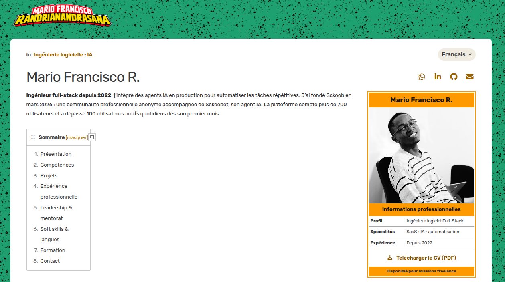

# Mario Francisco — Portfolio

I’m a software engineer focused on full-stack JavaScript, SaaS products, AI integrations, and workflow automation. I’ve been building and evolving software products since 2022.



## Stack

- React 19 and TypeScript
- TanStack Start and TanStack Router
- Tailwind CSS 4
- Vite
- Font Awesome
- Rubik typography

## Run locally

```bash
pnpm install
pnpm dev
```

